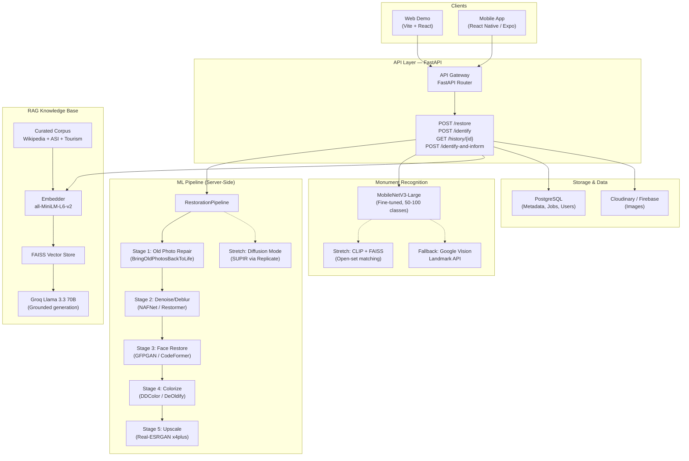
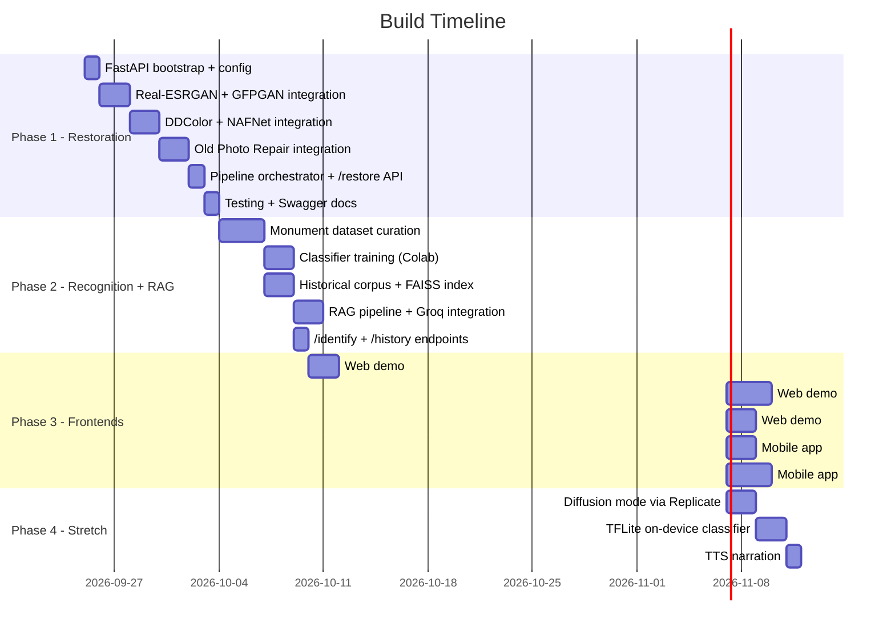

# 🏛️ AI Image Restoration & Historical Information Retrieval — Build Plan

> **Version:** 1.0 · **Owner:** Komal · **Status:** Ready for implementation
> **Monument scope:** India + World landmarks (50–100 classes)
> **Frontends:** Web demo (portfolio) + React Native (Expo) mobile app

---

## Architecture Overview



---

## Project Structure

```
f:\AI Image Restoration\
├── backend/                          # FastAPI Python backend
│   ├── app/
│   │   ├── main.py                   # FastAPI app entry, lifespan events
│   │   ├── config.py                 # Pydantic Settings (env vars)
│   │   ├── api/
│   │   │   ├── __init__.py
│   │   │   ├── router.py             # Main API router
│   │   │   ├── restore.py            # POST /restore, GET /restore/{job_id}
│   │   │   ├── identify.py           # POST /identify
│   │   │   ├── history.py            # GET /history/{monument_id}
│   │   │   └── combined.py           # POST /identify-and-inform
│   │   ├── models/
│   │   │   ├── schemas.py            # Pydantic request/response schemas
│   │   │   └── database.py           # SQLAlchemy models (Job, Monument, etc.)
│   │   ├── ml/
│   │   │   ├── __init__.py
│   │   │   ├── pipeline.py           # RestorationPipeline orchestrator
│   │   │   ├── stages/
│   │   │   │   ├── __init__.py
│   │   │   │   ├── old_photo_repair.py    # Stage 1: Scratch/crease repair
│   │   │   │   ├── denoise_deblur.py      # Stage 2: NAFNet / Restormer
│   │   │   │   ├── face_restore.py        # Stage 3: GFPGAN / CodeFormer
│   │   │   │   ├── colorize.py            # Stage 4: DDColor / DeOldify
│   │   │   │   └── upscale.py             # Stage 5: Real-ESRGAN
│   │   │   ├── classifier/
│   │   │   │   ├── __init__.py
│   │   │   │   ├── monument_classifier.py # MobileNetV3 inference
│   │   │   │   └── labels.json           # Class label mapping
│   │   │   └── rag/
│   │   │       ├── __init__.py
│   │   │       ├── embedder.py            # Sentence-transformer embedding
│   │   │       ├── retriever.py           # FAISS search
│   │   │       ├── generator.py           # Groq LLM grounded generation
│   │   │       └── corpus/                # Historical text chunks (JSON/MD)
│   │   ├── services/
│   │   │   ├── restoration_service.py     # Business logic for restoration
│   │   │   ├── identification_service.py  # Business logic for landmark ID
│   │   │   └── storage_service.py         # Image upload/download (Cloudinary)
│   │   └── utils/
│   │       ├── image_utils.py             # PIL/cv2 helpers
│   │       └── job_manager.py             # Job status tracking
│   ├── scripts/
│   │   ├── curate_corpus.py           # Script to build RAG knowledge base
│   │   ├── build_faiss_index.py       # Build FAISS index from embeddings
│   │   └── download_models.py         # Download all pretrained model weights
│   ├── tests/
│   │   ├── test_restore.py
│   │   ├── test_identify.py
│   │   └── test_rag.py
│   ├── requirements.txt
│   ├── Dockerfile
│   └── .env.example
│
├── classifier-training/               # Colab-ready monument classifier training
│   ├── train_monument_classifier.py    # Training script (MobileNetV3 transfer learning)
│   ├── dataset/                        # Curated monument images (gitignored)
│   │   └── README.md                   # Instructions for dataset setup
│   ├── export_onnx.py                  # Export to ONNX for inference
│   └── evaluate.py                     # Accuracy, confusion matrix
│
├── web-demo/                           # Vite + React web frontend
│   ├── index.html
│   ├── package.json
│   ├── vite.config.js
│   ├── src/
│   │   ├── main.jsx
│   │   ├── App.jsx
│   │   ├── index.css                   # Design system tokens
│   │   ├── pages/
│   │   │   ├── Home.jsx                # Landing page with two flows
│   │   │   ├── RestorePage.jsx         # Upload → restore → before/after
│   │   │   ├── IdentifyPage.jsx        # Upload/capture → monument card
│   │   │   └── HistoryDetail.jsx       # Full history screen
│   │   ├── components/
│   │   │   ├── BeforeAfterSlider.jsx   # Image comparison slider
│   │   │   ├── MonumentCard.jsx        # Recognition result card
│   │   │   ├── HistoryCard.jsx         # Historical info with sources
│   │   │   ├── UploadZone.jsx          # Drag & drop + gallery picker
│   │   │   ├── ProgressBar.jsx         # Restoration progress
│   │   │   └── Navbar.jsx
│   │   └── utils/
│   │       └── api.js                  # Fetch wrapper for backend
│   └── public/
│       └── assets/                     # Static images, icons
│
├── mobile/                             # React Native (Expo) app
│   ├── app.json
│   ├── package.json
│   ├── App.js
│   ├── app/
│   │   ├── (tabs)/
│   │   │   ├── index.jsx              # Home tab
│   │   │   ├── restore.jsx            # Restore tab
│   │   │   └── identify.jsx           # Identify tab
│   │   ├── history/[id].jsx           # History detail screen
│   │   └── _layout.jsx               # Root layout
│   ├── components/                     # Shared mobile components
│   └── services/
│       └── api.js                      # API client
│
├── data/                               # Shared datasets & knowledge base
│   ├── monuments.json                  # Monument metadata (name, id, era, location)
│   ├── corpus/                         # Historical text per monument
│   │   ├── taj_mahal.md
│   │   ├── colosseum.md
│   │   └── ...
│   └── sample_images/                  # Test degraded images
│
├── docs/
│   ├── PRD.md                          # This PRD
│   ├── API_SPEC.md                     # OpenAPI spec documentation
│   └── ARCHITECTURE.md                 # Architecture decisions
│
└── README.md                           # Project overview & setup guide
```

---

## Phase 1 — Restoration Core (Backend)

> **Goal:** Stand up FastAPI backend with a working 5-stage image restoration pipeline, testable via Swagger/Postman.

### 1.1 Project Bootstrap

| Step | Detail |
|------|--------|
| Initialize backend | Create `backend/` with FastAPI, uvicorn, python-dotenv, Pydantic Settings |
| Python version | 3.12 (match PRD) |
| Dependency mgmt | `requirements.txt` with pinned versions |
| Config | `.env.example` with `GROQ_API_KEY`, `CLOUDINARY_URL`, `DATABASE_URL`, model paths |
| Logging | `loguru` structured logging from day one |

### 1.2 Restoration Pipeline — `RestorationPipeline` class

```python
# Pseudocode — each stage is swappable/toggleable
class RestorationPipeline:
    def __init__(self, config: PipelineConfig):
        self.stages = []
        if config.enable_old_photo_repair:
            self.stages.append(OldPhotoRepairStage())
        if config.enable_denoise:
            self.stages.append(DenoiseDeblurStage())
        if config.enable_face_restore:
            self.stages.append(FaceRestoreStage())
        if config.enable_colorize:
            self.stages.append(ColorizeStage())
        if config.enable_upscale:
            self.stages.append(UpscaleStage())

    async def restore(self, image: np.ndarray, options: RestoreOptions) -> RestoreResult:
        result = image
        stage_outputs = []
        for stage in self.stages:
            result = await stage.process(result)
            stage_outputs.append(StageOutput(stage.name, result))
        return RestoreResult(final=result, stages=stage_outputs)
```

### 1.3 Stage-by-Stage Model Integration

| Stage | Model | Package/Repo | Weight file | Input → Output |
|-------|-------|-------------|-------------|----------------|
| 1 — Old Photo Repair | Microsoft BOPBTL | `microsoft/Bringing-Old-Photos-Back-to-Life` (GitHub) | Pretrained `.pth` | Degraded img → scratch/crease-repaired img |
| 2 — Denoise/Deblur | NAFNet | `megvii-research/NAFNet` | `NAFNet-REDS-width64.pth` | Noisy/blurry img → clean img |
| 3 — Face Restore | GFPGAN v1.4 | `pip install gfpgan` | `GFPGANv1.4.pth` | Damaged face regions → restored faces |
| 4 — Colorize | DDColor | `piddnad/DDColor` (GitHub) | `ddcolor_modelscope.pth` | B/W img → colorized img |
| 5 — Upscale | Real-ESRGAN | `pip install realesrgan` | `RealESRGAN_x4plus.pth` | Low-res img → 4x upscaled img |

> **Practical approach for Phase 1:** Start with **Real-ESRGAN** (stage 5) and **GFPGAN** (stage 3) first — they have the cleanest pip-installable APIs. Then add DDColor, NAFNet, and finally the Old Photo Repair model which requires more setup.

### 1.4 API Endpoints (Phase 1)

```yaml
POST /api/v1/restore:
  request: multipart/form-data (image file + JSON options)
  options:
    stages: ["denoise", "face_restore", "colorize", "upscale"]  # toggleable
    mode: "standard" | "enhanced"  # enhanced = diffusion (stretch)
  response:
    job_id: string  # for async polling
    status: "processing"

GET /api/v1/restore/{job_id}:
  response:
    status: "processing" | "completed" | "failed"
    original_url: string
    restored_url: string
    stages_applied: string[]
    processing_time_ms: int

GET /api/v1/health:
  response:
    status: "ok"
    models_loaded: string[]
```

### 1.5 Image Storage Flow

1. User uploads image → saved to temp dir
2. Pipeline processes → result saved to temp dir
3. Both original + restored uploaded to **Cloudinary** (free tier: 25GB)
4. URLs stored in PostgreSQL `jobs` table
5. Temp files cleaned up

### 1.6 Deliverables

- [x] FastAPI server running on `localhost:8000`
- [x] `/restore` endpoint accepting image uploads
- [x] At least 3/5 restoration stages working (ESRGAN + GFPGAN + DDColor minimum)
- [x] Swagger docs at `/docs`
- [x] Before/after image comparison working
- [x] Job status polling via `/restore/{job_id}`

---

## Phase 2 — Monument Recognition + RAG

> **Goal:** Fine-tune monument classifier, build RAG knowledge base, wire `/identify` and `/history` endpoints.

### 2.1 Monument Dataset Curation (50–100 Monuments)

**India landmarks (30+):**
Taj Mahal, Red Fort, Qutub Minar, India Gate, Hawa Mahal, Mysore Palace, Gateway of India, Charminar, Meenakshi Temple, Golden Temple, Hampi ruins, Konark Sun Temple, Ajanta Caves, Ellora Caves, Victoria Memorial, Brihadeeswara Temple, Sanchi Stupa, Khajuraho, Fatehpur Sikri, Jantar Mantar, Amber Fort, City Palace Jaipur, Lotus Temple, Agra Fort, Humayun's Tomb, Lal Qila, Rani ki Vav, Mahabalipuram Shore Temple, Nalanda University ruins, Padmanabhaswamy Temple

**World landmarks (30+):**
Colosseum, Eiffel Tower, Great Wall, Machu Picchu, Parthenon, Petra, Pyramids of Giza, Angkor Wat, Chichen Itza, Christ the Redeemer, Statue of Liberty, Big Ben, Leaning Tower of Pisa, Hagia Sophia, Sydney Opera House, Forbidden City, Stonehenge, Notre-Dame, Sagrada Familia, Burj Khalifa, Tower of London, Brandenburg Gate, Mount Rushmore, Lincoln Memorial, Alhambra, Versailles, Neuschwanstein Castle, St. Basil's Cathedral, Acropolis, Terracotta Army

**Images per class:** 150–300 (source: Wikimedia Commons CC + own photography + augmentation)

**Augmentation pipeline:**
- Horizontal flip, rotation (±15°), random crop (80–100%)
- Color jitter (brightness ±20%, saturation ±20%)
- Random Gaussian blur, perspective distortion
- Normalize to ImageNet mean/std

### 2.2 Classifier Training (Google Colab)

```python
# Transfer learning: MobileNetV3-Large
import torchvision.models as models

model = models.mobilenet_v3_large(weights='IMAGENET1K_V2')
model.classifier[-1] = nn.Linear(1280, num_monument_classes)  # Replace head

# Training config
optimizer = AdamW(model.parameters(), lr=1e-4)
scheduler = CosineAnnealingLR(optimizer, T_max=30)
criterion = CrossEntropyLoss(label_smoothing=0.1)

# Train for 30 epochs, should reach 93%+ on validation
# Export: torch.onnx.export(model, ...) for ONNX Runtime inference
```

### 2.3 RAG Knowledge Base

**Corpus structure per monument:**
```json
{
  "monument_id": "taj_mahal",
  "name": "Taj Mahal",
  "location": "Agra, Uttar Pradesh, India",
  "coordinates": [27.1751, 78.0421],
  "era": "1632–1653 CE",
  "builder": "Emperor Shah Jahan",
  "architectural_style": "Mughal architecture",
  "unesco_status": "World Heritage Site (1983)",
  "chunks": [
    {
      "text": "The Taj Mahal was commissioned in 1632 by the Mughal emperor Shah Jahan...",
      "source": "Wikipedia - Taj Mahal",
      "source_url": "https://en.wikipedia.org/wiki/Taj_Mahal"
    }
  ]
}
```

**Embedding + Indexing pipeline:**
1. Load all monument JSON files from `data/corpus/`
2. Split text into 256-token chunks with 50-token overlap
3. Embed with `sentence-transformers/all-MiniLM-L6-v2` (384-dim)
4. Build FAISS `IndexFlatIP` (inner product, fast for <10K vectors)
5. Save index + chunk metadata mapping

**RAG Generation (Groq):**
```python
async def generate_history(monument_id: str, query: str = None):
    # 1. Retrieve top-5 chunks from FAISS
    chunks = retriever.search(monument_id, query, top_k=5)

    # 2. Build grounded prompt
    context = "\n\n".join([f"[{c.source}]: {c.text}" for c in chunks])
    prompt = f"""Based ONLY on the following verified sources, write a concise 
    historical summary about {monument_name}. Cite sources inline.
    
    SOURCES:
    {context}
    
    RULES:
    - Only use information from the provided sources
    - Cite each fact with [Source Name]
    - If the sources don't contain enough information, say so
    - Never invent or assume historical facts"""

    # 3. Generate via Groq
    response = await groq_client.chat.completions.create(
        model="llama-3.3-70b-versatile",
        messages=[{"role": "user", "content": prompt}],
        temperature=0.3,  # Low temp for factual accuracy
        max_tokens=500
    )
    return response.choices[0].message.content
```

### 2.4 API Endpoints (Phase 2)

```yaml
POST /api/v1/identify:
  request: multipart/form-data (image)
  response:
    monument_id: string
    monument_name: string
    confidence: float
    location: string
    era: string
    image_url: string  # Reference image of the monument

GET /api/v1/history/{monument_id}:
  response:
    monument_id: string
    name: string
    summary: string  # RAG-generated, cited
    era: string
    builder: string
    sources: [{name, url}]
    related_images: [{url, caption, year}]
    timeline: [{year, event}]

POST /api/v1/identify-and-inform:
  request: multipart/form-data (image)
  response:
    identification: { monument_id, name, confidence }
    history: { summary, era, builder, sources[], timeline[] }
```

### 2.5 Deliverables

- [x] 50+ monument classes curated with 150+ images each
- [x] MobileNetV3 classifier achieving ≥90% top-1 accuracy
- [x] ONNX model exported for server inference
- [x] FAISS index built over curated historical corpus
- [x] RAG pipeline producing cited summaries via Groq
- [x] `/identify`, `/history`, `/identify-and-inform` endpoints live
- [x] Graceful "not recognized" handling for out-of-set images

---

## Phase 3 — Web Demo + Mobile App

> **Goal:** Build polished, portfolio-grade frontends for both web and mobile.

### 3.1 Web Demo (Vite + React)

**Design direction:** Dark glassmorphism with amber/gold accent (evokes ancient/heritage feel). Premium feel with smooth animations.

**Key screens:**

| Screen | Components | Interactions |
|--------|-----------|-------------|
| **Home** | Hero with particle background, two CTA cards ("Restore a Photo" / "Identify Monument"), feature highlights | Fade-in on scroll, hover lift on cards |
| **Restore** | UploadZone (drag+drop), stage toggles, progress bar, BeforeAfterSlider | Real-time stage progress, slider comparison |
| **Identify** | UploadZone or camera capture, MonumentCard result, "Read History" link | Confidence badge, smooth card reveal |
| **History Detail** | Hero image, timeline, cited summary, source links, related images, "Restore this" button | Scroll-driven timeline animation |

**BeforeAfterSlider component:**
- Draggable divider between original and restored image
- Touch-friendly on mobile
- Labels "Before" / "After" with semi-transparent overlays
- Smooth cursor tracking

### 3.2 Mobile App (React Native / Expo)

**Navigation:** Bottom tabs (Home, Restore, Identify) + stack navigation for detail screens.

| Screen | Notes |
|--------|-------|
| Home | Welcome + quick-access buttons |
| Restore | Expo Camera integration + image picker → upload → progress → result |
| Identify | Expo Camera / picker → monument card → history |
| History Detail | Full monument info, scrollable, "Restore old photo" shortcut |

**Key packages:**
- `expo-camera` — capture
- `expo-image-picker` — gallery
- `expo-file-system` — temp file management
- `react-native-reanimated` — smooth animations
- `expo-router` — file-based routing

### 3.3 Deliverables

- [x] Web demo: all 4 screens functional with premium UI
- [x] Before/after slider working smoothly
- [x] Mobile app: both flows (restore + identify) end-to-end
- [x] Camera capture integration on mobile
- [x] History detail with sourced facts
- [x] Responsive web design (desktop + tablet + mobile)

---

## Phase 4 — Stretch Features

> **Goal:** Enhanced quality options, offline capability, audio narration.

| Feature | Implementation | Priority |
|---------|---------------|----------|
| Diffusion "Enhanced Mode" | Replicate API (SUPIR/DiffBIR), gated behind toggle, ~1-2 min processing | High |
| On-device TFLite classifier | Export MobileNetV3 to TFLite, run in Expo via `react-native-tflite` | Medium |
| Audio narration | Coqui TTS or Google Cloud TTS, play button on history screen | Medium |
| Open-set CLIP+FAISS | CLIP ViT-B/32 embeddings, FAISS nearest-neighbor | Low |
| Google Vision API fallback | For unrecognized monuments, call Cloud Vision Landmark Detection | Low |
| User-contributed photos | Upload form per monument, moderation queue | Low |

---

## Non-Functional Requirements Checklist

| Requirement | Implementation |
|------------|---------------|
| Restoration < 15s (standard) | Pipeline stages run sequentially; benchmark each; skip unnecessary stages |
| Landmark ID < 3s (server) | ONNX Runtime inference is typically < 500ms; network overhead is the bottleneck |
| Graceful "not recognized" | Confidence threshold (e.g., < 0.6) → show "Not in database" message |
| Source citations on all facts | Every RAG chunk carries `source` and `source_url`; shown in UI |
| Error handling | Global exception handler in FastAPI; user-friendly error messages |
| CORS | Configured for web demo origin |

---

## Environment Variables

```env
# Backend (.env)
GROQ_API_KEY=gsk_...
CLOUDINARY_CLOUD_NAME=...
CLOUDINARY_API_KEY=...
CLOUDINARY_API_SECRET=...
DATABASE_URL=postgresql://...
MODEL_DIR=./models
REPLICATE_API_TOKEN=...          # Stretch: diffusion mode
GOOGLE_VISION_API_KEY=...        # Stretch: fallback
```

---

## Evaluation Metrics

| Metric | Tool | Target |
|--------|------|--------|
| PSNR (restoration) | `skimage.metrics.peak_signal_noise_ratio` | > 28 dB |
| SSIM (restoration) | `skimage.metrics.structural_similarity` | > 0.85 |
| LPIPS (perceptual quality) | `lpips` pip package | < 0.15 |
| Classifier top-1 accuracy | sklearn `accuracy_score` | > 90% |
| Classifier top-5 accuracy | Custom metric | > 98% |
| RAG factual accuracy | Manual spot-check (50 samples) | 100% (no hallucination) |

---

## Risk Mitigations (Implementation-Ready)

| Risk | Mitigation | Code Pattern |
|------|-----------|-------------|
| Models too large for server RAM | Lazy-load stages; unload after inference if memory constrained | `torch.cuda.empty_cache()` + model registry |
| Restoration takes > 15s | Profile each stage; skip stages with negligible improvement | Per-stage timing decorator |
| FAISS index too small for good retrieval | Add 10+ chunks per monument; fallback to full monument text | Chunk overlap + metadata retrieval |
| Groq rate limits | Implement retry with exponential backoff; cache recent responses | `tenacity` retry decorator |
| Classifier low confidence on real photos | Multi-crop inference (5 crops → average logits); confidence calibration | Temperature scaling post-training |

---

## Build Order (Recommended)



---

> [!IMPORTANT]
> **Next step:** Approve this plan to begin Phase 1 implementation — FastAPI bootstrap, model downloads, and restoration pipeline setup.

